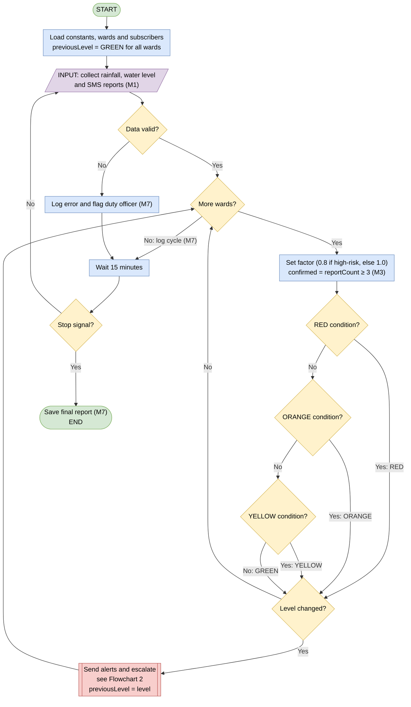
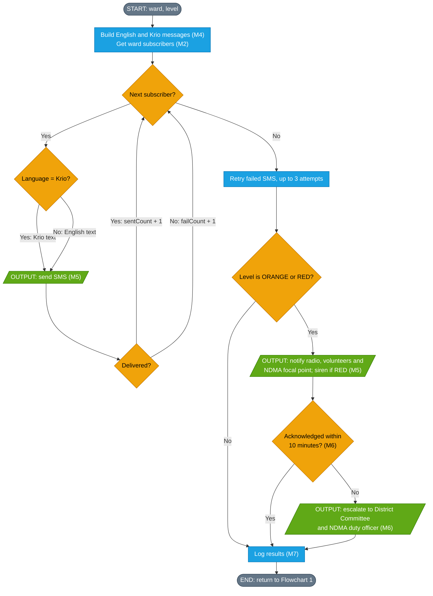

# Freetown Community Flood Early Alert System (FCFEAS)

**PROG101: Principles of Programming Logic and Design** | Assignment 1: Designing Logical Solutions for Sierra Leone Community Challenges

Limkokwing University of Creative Technology, Sierra Leone | Department of Information and Communication Technology | Semester 01, September 2026 to January 2027

**Student:** Emmanuel Alvin Macarthy | **Student ID:** 905006553 | **Examiner:** Elijah Fullah

> This is a **logical design only**. No source code is written, as the assignment requires. The solution is described using computational thinking, an algorithm, pseudocode, flowcharts and modular design.

---

## 1. The community problem

Freetown floods every rainy season, but the warning that reaches a family in a flood-prone settlement is often late, unclear or absent. The problem addressed here is the **lack of a timely, ward-specific and easily understood flood alert that connects weather and water data to community action**.

- **Who is affected:** residents of low-lying coastal and riverside settlements such as Kroo Bay, Portee and Rokupa, and hillside areas such as Regent. Informal-settlement households, women, children, older people and people with disabilities suffer most.
- **Why it exists:** rapid population growth pushes households onto floodplains and steep slopes, the warning chain is fragmented, and many people cannot be reached by text-heavy or internet-based messages.
- **How FCFEAS helps:** it collects rainfall, water-level and community readings, classifies every ward into one of four alert levels, sends short SMS alerts in English and Krio, activates volunteers and radio for serious alerts, and escalates automatically if nobody acknowledges.

## 2. How the system works

FCFEAS is a monitoring cycle that repeats every **15 minutes**.

- **Inputs:** 24-hour rainfall (`rain24`), hourly rainfall intensity (`rainHr`), water level as a percentage of channel capacity (`waterPct`), and SMS flood reports from residents (`reportCount`).
- **Processing:** data validation, risk classification per ward, message creation, retries and escalation rules.
- **Outputs:** SMS alerts, radio and volunteer notifications, sirens for the highest level, and an audit log.

### Alert levels

Thresholds are illustrative and must be calibrated with SLMet and NDMA. Rainfall thresholds are multiplied by 0.8 in high-risk wards. "Confirmed" means at least 3 community reports in the cycle.

| Level | Trigger (any one condition) | Public action |
| --- | --- | --- |
| **GREEN** | Below all thresholds | No alert. "All clear" is sent when returning from a higher level. |
| **YELLOW** | rain24 ≥ 50 mm, or water level ≥ 60% | Be alert: clear drains, secure belongings, listen to radio. |
| **ORANGE** | rain24 ≥ 100 mm, or water ≥ 80%, or (rain24 ≥ 50 mm and confirmed reports) | Prepare to move. Volunteers activated. |
| **RED** | rain24 ≥ 150 mm, or water ≥ 100%, or (rainfall ≥ 30 mm/h and confirmed reports) | Move to higher ground now. Siren and door-to-door alert. |

Alerts are sent **only when a ward's level changes**, so residents are not flooded with repeated messages.

## 3. Repository contents

| File | Description |
| --- | --- |
| `README.md` | This file: project overview and index |
| `Freetown_Flood_Early_Alert_System_Report.docx` | The full written report |
| [`pseudocode.md`](pseudocode.md) | Pseudocode for the main program and all seven modules |
| `algorithm.md` | Step-by-step algorithm (add this file if you include it) |
| `Flowchart_1_Main_Monitoring_Cycle.png` | Flowchart 1 (image) |
| `Flowchart_2_Alert_Dissemination_and_Escalation.png` | Flowchart 2 (image) |
| `*.drawio` | Editable draw.io source files for both flowcharts |
| `LICENSE` | Open-source licence (AGPL-3.0) |

## 4. Flowcharts

Two flowcharts show the whole design. Each step is tagged with the module (M1 to M7) that performs it. They are drawn below with Mermaid so they display directly on GitHub, and the draw.io versions are also in this repository as PNG images (`Flowchart_1_Main_Monitoring_Cycle.png` and `Flowchart_2_Alert_Dissemination_and_Escalation.png`).

### Flowchart 1: Main monitoring cycle, ward processing and risk classification

The WHILE loop that runs every 15 minutes, the validation decision, the FOR EACH loop over wards, and the RED, ORANGE, YELLOW or GREEN decision cascade.



### Flowchart 2: Alert dissemination and escalation

Called from Flowchart 1 when a ward's level changes: the loop over subscribers, English or Krio selection, SMS retries, notification of radio and volunteers, and escalation if nobody acknowledges within 10 minutes.



## Pseudocode

The complete pseudocode for the main program and all seven modules is in **[pseudocode.md](pseudocode.md)**. The main program is shown here:

```text
PROGRAM FreetownFloodAlertSystem
   // ----- Constants -----
   CONSTANT CYCLE_MINUTES = 15
   CONSTANT RAIN_YELLOW = 50, RAIN_ORANGE = 100, RAIN_RED = 150   // mm in 24 hours
   CONSTANT INTENSITY_RED = 30                                    // mm per hour
   CONSTANT WATER_YELLOW = 60, WATER_ORANGE = 80, WATER_RED = 100 // % of channel
   CONSTANT CONFIRM_COUNT = 3
   CONSTANT HIGH_RISK_FACTOR = 0.8
   CONSTANT ACK_WAIT_MINUTES = 10, MAX_RETRIES = 3
   CONSTANT RAIN24_MAX = 500, RAINHR_MAX = 200, WATER_MAX = 300
   // ----- Variables -----
   DECLARE wards AS ARRAY OF Ward
   DECLARE data AS ARRAY OF WardData
   DECLARE previousLevel AS ARRAY OF STRING
   DECLARE level AS STRING
   DECLARE pair AS MessagePair                 // pair.english and pair.krio
   DECLARE systemRunning AS BOOLEAN

   CALL loadWards(wards)
   FOR EACH ward IN wards DO
      SET previousLevel[ward.code] = "GREEN"
   END FOR
   SET systemRunning = TRUE

   WHILE systemRunning = TRUE DO
      SET data = collectData(wards)
      IF isValidData(data) = FALSE THEN
         CALL logEvent("INVALID DATA", "Duty officer review needed")
      ELSE
         FOR EACH ward IN wards DO
            SET level = calculateRiskLevel(ward, data[ward.code])
            IF level <> previousLevel[ward.code] THEN
               SET pair = buildMessage(ward, level)
               CALL sendAlerts(ward, level, pair)
               CALL checkEscalation(ward, level)
               SET previousLevel[ward.code] = level
            END IF
         END FOR
         CALL logEvent("CYCLE COMPLETE", previousLevel)
      END IF
      WAIT CYCLE_MINUTES minutes
      IF stopSignalReceived() = TRUE THEN SET systemRunning = FALSE
   END WHILE
   CALL saveFinalReport()
END PROGRAM
```

## 5. Computational thinking

| Technique | Application |
| --- | --- |
| **Decomposition** | The system is split into seven modules (below). |
| **Pattern recognition** | The same wards flood repeatedly and in the same sequence: heavy rain, rising water, resident reports, damage. This justifies thresholds, a high-risk ward list and report confirmation. |
| **Abstraction** | Soil type, drain design and terrain are ignored. Each ward is reduced to four numbers: rain24, rainHr, waterPct and reportCount. |
| **Algorithm design** | An ordered cycle of input, validation, decision cascade, loops over wards and subscribers, and escalation. |

## 6. Modular design

| Module | Purpose | Functions |
| --- | --- | --- |
| **M1 Data Collection** | Gather and validate readings and SMS reports | `collectData`, `receiveSMSReport`, `isValidData` |
| **M2 Subscriber Management** | Register and remove residents (JOIN and STOP) | `registerSubscriber`, `removeSubscriber`, `getSubscribers` |
| **M3 Risk Analysis** | Classify each ward | `calculateRiskLevel`, `isHighRiskWard` |
| **M4 Message Builder** | Create short alert text in English and Krio | `buildMessage` |
| **M5 Alert Dissemination** | Deliver alerts by SMS, radio, volunteers and siren | `sendAlerts`, `notifyRadioAndVolunteers`, `triggerSiren` |
| **M6 Escalation** | Make sure serious alerts are acted on | `checkEscalation` |
| **M7 Logging and Reporting** | Keep an audit trail and reports | `logEvent`, `saveFinalReport` |

Programming logic concepts used: constants, variables, data types, Boolean logic, decision structures, repetition structures (WHILE and FOR EACH), functions, modular design and problem decomposition.

## 7. Sample scenarios (expected outputs)

KROO, PORTEE, CULVERT and REGENT are treated as high-risk wards (factor 0.8) and HILLST as a standard ward (factor 1.0). The full set of ten scenarios is in the report.

| Inputs | Result |
| --- | --- |
| KROO: rain24 45 mm, rainHr 8, waterPct 40, reports 0 | 45 ≥ 50 × 0.8 = 40, so the level becomes **YELLOW** and an SMS is sent to KROO subscribers. |
| HILLST: rain24 45 mm, same other values | Factor 1.0, and 45 < 50, so the level stays **GREEN**. No SMS. |
| CULVERT: rain24 55 mm, rainHr 32, waterPct 70, reports 4 | rainHr 32 ≥ 30 and confirmed, so the level is **RED**. SMS, radio, volunteers and siren. If nobody acknowledges in 10 minutes, the District Committee and NDMA duty officer are called. |
| KROO: rain24 −5 mm (faulty gauge) | `isValidData` returns FALSE. No alerts this cycle. The error is logged for the duty officer, and previous levels stay in force. |

## 8. Sustainable Development Goals

- **SDG 11, Sustainable Cities and Communities** (Target 11.5): earlier, targeted warnings reduce deaths, injuries and losses from disasters.
- **SDG 13, Climate Action** (Targets 13.1 and 13.3): a repeatable early-warning logic that builds local capacity.
- **SDG 1, No Poverty** (Target 1.5): protects households with the least capacity to recover from flood shocks.
- **SDG 9, Industry, Innovation and Infrastructure** (Target 9.c): works on basic mobile phones with SMS, so no smartphone or data plan is required.

## 9. Open source and Digital Public Goods

- **Why open source:** a public-safety service should not depend on one vendor, and its rules must be open to inspection so that thresholds can be trusted and improved.
- **Benefits for Sierra Leone:** no licence fees, no vendor lock-in, skills for local developers and students, and reuse in other flood-affected districts.
- **Community contributions:** Krio, Mende and Temne translations, threshold calibration by hydrologists, ward and risk data, low-cost sensor integrations, testing and documentation.
- **Digital Public Good route:** target SDGs 11 and 13, use an OSI-approved licence (AGPL-3.0), publish anonymised alert logs as open data, use open standards such as REST/JSON and the Common Alerting Protocol, collect minimal personal data with consent, and prevent harm through validation, audit logs and escalation to humans. Formal DPG status requires nomination and review by the Digital Public Goods Alliance.

## 10. Limitations

- The thresholds are illustrative and must be calibrated with SLMet and NDMA.
- The Krio message templates must be written and approved by community translators before use.
## AUTHOR
EMMANUEL_ALVIN_MACARTHY_905006553


